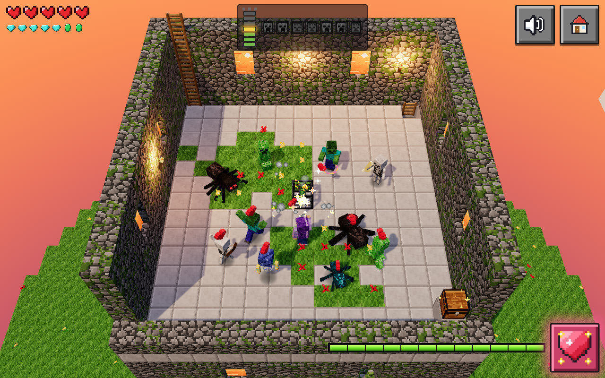

# Critter Battle Tower 3D: Heart Mob Climb!

**Play Live:** [https://kunruiw1991.github.io/critters-battletower3d/](https://kunruiw1991.github.io/critters-battletower3d/)

## Short Pitch

Climb a sunlit 7-storey voxel Battle Tower by throwing bouncy red pixel hearts to turn grumpy dungeon critters into a cheering, dancing conga parade! Built from the ground up in real 3D with Three.js r161 for a 5-year-old who cannot read, every interaction is 100% icon-driven, joyful, and gentle—where nobody gets hurt, every monster becomes a friend, and reaching the rooftop crowns the climb with a friendly Iron Golem shoulder ride and sunset fireworks.

---

## Gameplay Highlights

- **Hearts Befriend Mobs**: Tap any grumpy critter to toss a parabolic 3D voxel heart with homing lead-prediction. Once a critter's love meter fills, it freezes, hops with a 360-degree celebratory spin, bursts into hearts and green XP orbs, gains a permanent bobbing overhead heart, and joins your team.
- **Friend Parade & Active Helpers**: Up to 12 befriended critters follow the hero in a lively breadcrumb conga line (and gather into a hopping circle dance when the hero stops). Friends actively help during combat: melee friends dash out for a +1 love hug, skeleton/stray friends loose homing heart-tipped arrows, and breeze friends puff grumpy mobs back.
- **6 Distinct Tower Floors + Iron Golem Rooftop Boss**:
  1. **Floor 1 — Zombie Hall**: Shuffling green zombies, tutorial pointing-hand and drag-hand hints, and a wooden corner chest.
  2. **Floor 2 — Spider Den**: Spiders crawling along the mossy cobblestone walls before descending on silk threads and hop-pouncing, plus speedy teal cave spiders and sticky corner cobwebs.
  3. **Floor 3 — Skeleton Gallery**: Ranged skeletons with glowing bow-draw telegraphs and four cobblestone pillars that block arrows and hearts.
  4. **Floor 4 — Creeper Garden**: Creepers that swell and hiss on a 1.6 s fuse with 3D sparks and a red ground warning ring—befriend them in time to defuse, or watch them pop into harmless pastel confetti and flowers before respawning.
  5. **Floor 5 — Breeze Loft**: Floating Breezes with spinning wind rods that launch the hero high into a joyful airborne spin (`wheee!`—zero damage, mid-air heart throws enabled) alongside frost-slowing Strays and drifting sky-window wind particles.
  6. **Floor 6 — Big Swarm**: Twin mob spawners releasing waves of mixed critters where your 12-friend helper army shines, plus two corner chests.
  7. **Floor 7 — Roof (Golem Crown)**: Open sunset sky with drifting voxel clouds, crenellated parapet, waving flag, and the towering Iron Golem boss. Dodge its telegraphed red ground-slam circles (and Phase 2 double slams) while showering it with 14 hearts—then accept its red poppy gift, ride on its shoulder, and tap the roof to launch extra heart fireworks!
- **Wooden Chests & Magnetized 3D Voxel Loot**: Walk near any corner chest to pop its lid open and fountain 3D voxel items—Golden Apples (+2 health hearts), Cookies (all friends hop and cheer), Diamonds, Emeralds, and the rooftop Golden Trophy.
- **XP Bar & Room-Wide Heart-Bomb**: Every befriended critter drops 3 green XP orbs that zoom to the hero with a rising chime. Collecting 12 orbs arms the neon-pink Heart-Bomb button (`#btn-bomb`), unleashing a 5-wave expanding heart shockwave that adds +2 love to every grumpy mob in the room.

---

## How to Play

### Touch & Mouse (Direct Manipulation)
- **Tap a Grumpy Critter**: Throws a homing 3D voxel heart at that critter.
- **Press & Hold / Drag on the Floor**: The hero walks 1:1 toward your finger or cursor; release to stop.
- **Tap a Chest, Glowing Ladder, or Poppy Gift**: Auto-pathfinds around spawners and pillars to open the chest, climb to the next floor once cleared, or accept the Iron Golem's poppy.
- **Tap the Glowing Heart-Bomb Button** (bottom-right, when XP bar is full): Unleashes a room-wide +2 love heart shockwave.
- **Tap the Rooftop During the Finale**: Launches extra heart firework rockets into the sunset sky.

### Keyboard
- **WASD / Arrow Keys**: Move the hero across the room.
- **Space**: Throw a heart at the nearest grumpy critter.
- **Enter / E**: Interact with nearby chests, ladders, or the rooftop poppy gift, or trigger the Heart-Bomb when charged.

---

## Design Rules for a 5-Year-Old

- **Zero Text (`innerText === ''`)**: Zero letters or words anywhere in the DOM, HUD, title screen, end card, or procedural canvas textures. All communication uses expressive 16x16 pixel icons, mob-face pips, star rows, and animated pointing-hand / bouncing-arrow hints.
- **Zero Voice / TTS**: Zero `speechSynthesis` usage anywhere in the codebase. Every cue is musical or non-speech procedural synthesis.
- **At Most 6 Big Controls (`>= 80 CSS px`)**: Every screen displays at most 2–3 large, high-contrast pixel-art buttons measuring `84x84` to `150x150` CSS px (`#btn-play`, `#btn-restart`, `#btn-sound`, `#btn-home`, `#btn-bomb`, `#btn-replay`), with zero nested menus, tabs, or scrollbars across portrait (`390x844`), landscape (`844x390`), tablet (`1024x768`), and desktop (`1280x800`).
- **Gentle Failure**: Losing all 5 hearts triggers a gentle 1.2 s cloud poof and respawns the hero at the floor entrance with 5 full hearts and brief invulnerability. Already-befriended critters stay friends, and the child never hits a "Game Over" screen or loses progress.

---

## Technical Architecture & Notes

- **Three.js r161 Voxel Engine**: Real 3D scene (`WebGLRenderer`, `SRGBColorSpace`, `ACESFilmicToneMapping`, `PCFSoftShadowMap`) with fixed light counts (hemisphere fill, directional sunset window light, and 3 flickering torch point lights) and startup shader precompilation (`renderer.compile`) to eliminate mid-game shader hitches.
- **Procedural 16x16 Pixel-Grid Textures & Rigged Voxel Models (`src/textures.js`, `src/models.js`)**: Multi-tone shaded pixel textures (`NearestFilter`) generated at boot—Voronoi mossy cobblestone with random-walk moss clumps, beveled smooth-stone floor tiles, alpha-tested spawner cages that bloom into flowering bushes on floor clear, and articulated Minecraft-proportioned rigs (`Zombie`, `Spider`, `Cave Spider`, `Skeleton`, `Stray`, `Creeper`, `Breeze`, `Iron Golem`, and the purple-haired `Hero`).
- **Fixed `1/120 s` Physics Substeps & Corner-Safe Pathfinding (`src/physics.js`, `src/hero.js`)**: Circle-vs-solid-cell AABB collision with full normal depenetration, mob–mob separation, gravity and parabolic arcs, wall-plane spider crawling, and an 8-connected corner-safe grid Dijkstra pathfinder for tap-to-walk interactions.
- **Bounded GPU Memory (`src/fx.js`, `src/projectiles.js`)**: 10 pre-allocated `InstancedMesh` particle pools (up to 1,360 simultaneous particles in 10 draw calls) and fixed-capacity projectile object pools ensure zero geometry or texture leaks across multi-campaign replays (`< 140` draw calls).
- **100% Procedural WebAudio Engine (`src/audio.js`)**: Master compressor, music/SFX buses, generated-IR convolution reverb, 3 procedural music tracks (`calm` C418-style pentatonic kalimba/piano, `boss` rooftop groove, `victory` brass fanfare), and 31 synthesized SFX with polyphony capping (`MAX_VOICES = 24`) and per-cue throttling.
- **Deterministic Test & Automation Hooks (`window.__game`)**: Exposes `state()`, `step(dt)`, `pause()`, `resume()`, `startGame(floorIdx, opts)`, `skipToFloor(n)`, `befriendAll()`, `hurtHero(n)`, `heartBomb()`, `visibleControls()`, and `bot` helpers for headless fast-forward simulations.

---

## Inspiration Credit

Inspired by the Bilibili video **BV1hkpt6oEfU** (*"随心配?(10) 战斗高塔"* by **Jt-sun**), episode 10 of a Minecraft Battle Tower mod series featuring stacked mossy-cobblestone tower rooms, smooth-stone tile floors, wall-crawling spiders, breeze wind launches, and floating red pixel hearts over crowds of mobs. Reimagined from the ground up as a wholesome, kid-safe 3D heart-friendship game for a 5-year-old.

*Fan-made independent web game; not affiliated with or endorsed by Mojang Studios or Microsoft.*

---

## Testing Changelog (10-Round Creator/Critic Loop & 3-Auditor Red-Team Gate)

### Multi-Round Creator/Critic Iterative Verification (`/tmp/bt3d_qa/critic_rounds_result.json`)
- **Round 1 — Core Loop & Controls (`changes` -> `approve`)**: Added an 8-connected corner-safe Dijkstra pathfinder (`buildPath`) so tap-to-walk on chests/ladders routes cleanly around center spawners and pillars; removed portrait over-zoom so SW/SE corner chests stay inside `390x844`; delayed upper-floor slab reveal during ladder climbs (`u >= 0.35..0.72`) so the climbing hero is never occluded; reset `save.unlocked = 0` on fresh restart; fixed West/East wall-spider `vz` velocity for lead-aimed heart throws; enabled rooftop firework taps during the finale/end card; and replaced all End Card digits with pure icon pip rows.
- **Round 2 — Visual Art & Lighting vs. Video (`changes` -> `approve`)**: Reserved floating overhead 3D red hearts strictly for befriended allies (`m.isFriend === true`) while giving partially-loved grumpy mobs a flat floor progress ring (`loveRingTex`); added continuous exterior tower shaft storeys (`extFloors`) beneath Floors 2–7 and sunset sky + drifting 3D voxel clouds on upper floors and the roof; tuned finale firework burst height and kept the 12-mob finale dance crowd in a front/side semi-circle so the hero on the Golem's shoulder is never obscured; added ambient Floor 5 wind-swirl particles and a high-contrast indigo Breeze palette with a translucent wind shell; angled north-wall spiders toward the camera between the sunset windows; and recessed all wall windows with stone lintels.
- **Round 3 — Child UX & HUD (`changes` -> `approve`)**: Aligned `#hint-hand`, `#hint-gift`, and `#hint-arrow` anchor coordinates and bound their padded DOM rects in `tap()`/`pickGrumpy()`; placed `#hint-drag` with an upward-pointing hand icon on the open floor clear of `#xpbar` and `#btn-bomb`; dynamically matched End Card gem pip totals to exact tower collectibles (`8` diamonds, `2` emeralds) with a smiling friend-heart badge; relaxed touch tap vs. hold thresholds (`TAP_MS = 400 ms`, `TAP_PX = 24 px`, `HOLD_MS = 260 ms`) for 5-year-old fingers; and gated `#btn-bomb.ready` strictly to active fights while hiding `#hud-bottom` during the finale.
- **Round 4 — Balance & Progression via Fast-Forward Sims (`approve` + 4 polish fixes -> `approve`)**: Tuned per-heart knockback (`0.85` with `0.35` diminishing return within `0.5 s`) so approaching mobs cannot be infinitely stunlocked; added `G.fx.collectAllXp()` on ladder climb and poppy pickup so in-flight XP orbs are never left behind; preserved larger saved `friendKinds` parades when replaying earlier floors; and displayed the 3-star celebration banner on Roof Golem kneel.
- **Round 5 — Mob AI & Signature Mechanics (`approve` + 2 polish fixes -> `approve`)**: Re-clamped room wall bounds after corner solid-cell depenetration in `collideCircle()` (verified across 304 wind-launch stress tests with `0` out-of-bounds substeps); added vertical Y tracking to friendly Breeze puffs so they hit wall-crawling spiders; and wired friendly Breeze creeper-fuse interrupts to `G.mobSys.stopFuse(m, true)`.
- **Round 6 — Responsive Layouts & Camera Framing (`changes` -> `approve`)**: Unhid `#hud-bottom` during `showHUD()` and `layout()` measurements so resizing during the Finale/End Card or resuming the Roof never corrupts `playBand.bottom`; arranged `#title-btns` horizontally on `844x390` landscape phones so `#btn-play` never overlaps `#btn-sound2`; wrapped `#gems` at 7 per row (`max-width: 166px`) on `390x844` portrait phones; eliminated double `refit()` on resize with immediate camera target snap; and enabled smooth portrait hero-follow zoom (`1.07x`).
- **Round 7 — Audio (`approve` + 4 polish fixes -> `approve`)**: Staggered XP orb spawns (`+0.075 s`) and collection (`0.055 s` cadence) with an unthrottled `'sparkle'` cue on full XP bar so 100% of rising XP chimes play; balanced music bus levels (`LEVEL.music = 0.21`) and boosted quiet SFX (`spider`, `climb`, `creeperFuse` with ducking, `throw`, `skeleton`) so all 31/31 SFX sit clearly above background music (`checks.musicBelowSfx === true`, all peaks `< 0.90`); and triggered `'star'`, `'hop'`, and `'sparkle'` SFX across floor clears, End Card stars, and mob hops.
- **Round 8 — Performance, Memory & Robustness (`changes` -> `approve`)**: Sanitized `localStorage` `friendKinds` against valid non-golem `MOB_KINDS` with a safe fallback in `spawn()`; enforced `MAX_FOLLOWERS = 12` immediately on `befriend()` and `enterFloor()` with `fIndex` re-indexing; ensured `window.__game.befriendAll()` during the `0.8 s` intro spawns `def.start` mobs (preventing Roof soft-lock); bound `resetInputState()` to both `window.blur` and `document.visibilitychange`; and capped projectile pools at their pre-warmed capacity (28 slots) by recycling the oldest active projectile.
- **Round 9 — Fun, Juice & Polish (`changes` -> `approve`)**: Drove `#clearstars` timeout via game time across all phases and hid it on entering `gift`/`finale`/`end`/`climb`; changed the Hero's Breeze wind-launch tumble to a Y-axis twirl with trailing wind swirls so her head never clips the floor and her shadow stays grounded; expanded `BOMB_RADIUS` to `20.0` with a 5-wave room-spanning shockwave; triggered full 360-degree spins on idle-ring friends when floor clear or cookies fire; added 16 Hz 3D fuse sparks/smoke and a 2.2-block red ground warning ring to fusing Creepers; and added `#fade` screen transitions, a Hero arrival hop from the ladder hole, and idle golden sparkles on unopened corner chests.
- **Round 10 — Zero-Defect Full Verification (`approve`, 0 issues)**: Verified end-to-end across all 7 floors, finale, end card, and 4 viewports (`1280x800`, `1024x768`, `844x390`, `390x844`) with 0 DOM text, 0 console errors, 100% Kid-Bot 3-star campaign completion, Idle-Bot poof/respawn recovery, Creeper pop respawn recovery, and flat GPU memory (`40` geometries, `76` textures) across 3 full campaign replays.

### 3-Member Independent Red-Team Gate
- **Attempt 1 Votes**: `["PASS", "PASS", "PASS"]` (Unanimous 3/3 pass on the first gate attempt).
